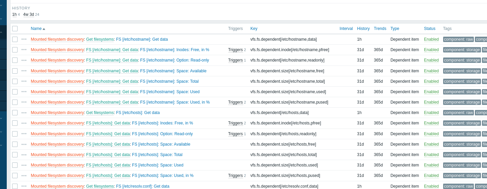
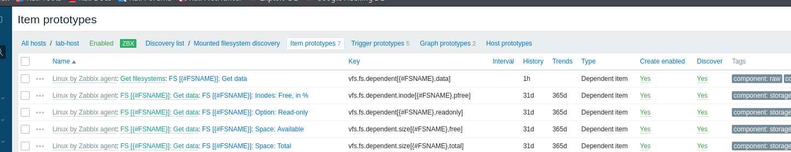

# Day 1 — Zabbix Monitoring and Incident Diagnostics

**Date:** 2026-10-20  
**Environment:** Local Linux host; Docker Engine 28.5.2; Docker Compose 2.40.3-3; Zabbix 7.0 (7.0.31 shown in UI); PostgreSQL 16.

## Objective

Deploy a self-hosted monitoring stack, connect an agent, create a custom item/trigger, simulate an incident, and verify automated event recovery.

## Infrastructure

Four Compose services: PostgreSQL (`zbx-postgres`), Zabbix Server (`zbx-server`), Web UI (`zbx-web`), and Agent 2 (`zbx-agent`). PostgreSQL keeps data on the persistent named volume `zabbix-lab_zbx-pgdata`. Web UI is bound to localhost; Zabbix server and agent ports are not exposed on the host.

## Verified outcomes

1. Installed Compose v2 and started all four containers.
2. Created host `lab-host` with the `Linux by Zabbix agent` template.
3. Resolved the agent restart loop caused by duplicated `zabbix-server` entries in the `Server` parameter.
4. Investigated Zabbix agent name-resolution failure after fixing the restart loop. Docker DNS resolved `zabbix-agent`, but Zabbix still reported `Cannot resolve address`. Temporarily switching the agent interface to `172.18.0.5` restored connectivity; the application-level DNS issue remains unresolved.
5. Confirmed metrics were visible in **Monitoring → Latest data**.
6. Created custom item `vfs.fs.size[/labdisk,pused]` with a 30-second interval.
7. Added a High severity trigger `last(/lab-host/vfs.fs.size[/labdisk,pused])>80`.
8. Filled a 64 MiB tmpfs with 54 MiB of test data. Zabbix detected the event and then recovered automatically after the file was removed; observed incident duration: **30 seconds**.
9. Inspected filesystem Low-Level Discovery (LLD), including **7 item prototypes**, **5 trigger prototypes**, **2 graph prototypes**, and automatically discovered per-filesystem items such as `/etc/hosts` and `/etc/resolv.conf`.

## Evidence

| Event | Screenshot |
| --- | --- |
| Disk usage trigger — detected 03:17:58 PM; recovered 03:18:28 PM (30s) |  |
| Filesystem items generated by LLD |  |
| LLD item prototypes and macros |  |

## Lessons

- A running container does not guarantee a working monitoring connection.
- Logs can distinguish configuration validation failures from name resolution and network failures.
- Items collect values; triggers evaluate expressions; actions and media types control outbound notifications.
- LLD discovery rules plus item/trigger prototypes generate monitoring entities for matching objects.
- Observability is more useful when paired with a safe, reproducible failure scenario.

## Limitations / work remaining

- **Telegram:** marked as completed by the lab operator based on prior familiarity, but setup and delivery were **not tested** in this lab.
- **Network LLD:** not individually tested; filesystem LLD was verified.
- **DNS:** the agent interface was changed to the ephemeral Docker IP `172.18.0.5` to restore metrics. Stable name-based connectivity still needs troubleshooting and verification.
- **Default host:** `Zabbix server` in the UI still showed an agent availability problem.
- **Export:** the supplied `Lab disk monitoring` template export contains only the custom item, **not** the manually configured host trigger. A derived candidate YAML with the trigger is provided but **not import-tested**.
- **Host coverage:** metrics are taken from the agent container, not directly from the Linux host.

## Portfolio status

Day 1 monitoring and incident simulation: **passed**. Before calling this stack fully reproducible, complete the remaining portability checks and template-import validation.
