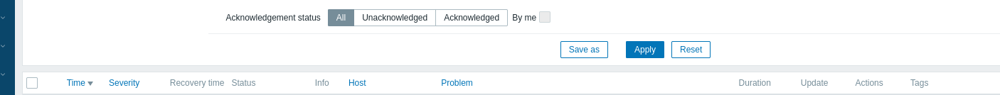

# Scenario 01 — Disk usage exceeds 80%

**State:** Reproduced and recovered on 2026-10-20. **Scope:** agent container's isolated tmpfs, not Kali's filesystem.

## Monitoring

- Host: `lab-host`
- Item: `vfs.fs.size[/labdisk,pused]` (`Numeric (float)`, `30s`, `%`)
- Trigger: `last(/lab-host/vfs.fs.size[/labdisk,pused])>80`
- Severity: High

## Reproduction

```bash
sudo docker exec zbx-agent df -h /labdisk
sudo docker exec zbx-agent sh -c 'dd if=/dev/zero of=/labdisk/fill.bin bs=1M count=54'
sudo docker exec zbx-agent df -h /labdisk
```

The size limit is 64 MiB; writing 54 MiB should raise usage to around 84%. **Never replace `/labdisk` with the actual host root filesystem.**

Check **Monitoring → Problems** for `Lab disk usage above 80%`. Allow one polling interval plus processing time.

## Recovery

```bash
sudo docker exec zbx-agent rm -f /labdisk/fill.bin
sudo docker exec zbx-agent df -h /labdisk
```

## Observed result

- Problem detected at 03:17:58 (time displayed in Zabbix UI).
- Recovery at 03:18:28.
- Duration: 30 seconds.



**Limitation:** severity and recovery verified through the UI, not through Telegram notification delivery.
